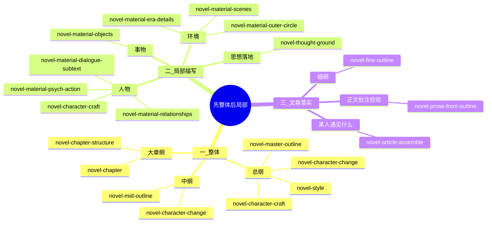

# Novel Workflow

用户已点名写正文 / 写中纲 / 写细纲 / 写场卡 / 写总纲时，不要先读本文件；直接走对应 skill。

先整体后局部。先写总纲，再写中纲（一个部分的总结），再拆大章纲和场卡，后面到人物、环境、事物的描写；需要在这里就表达出思想，人物会有什么变化，背景有什么变化，这些都要写出来。这些有思想有深度的落地之后，再到最后文章的具体落实，比如什么某人遇见什么事情。在正文需要写一下批注：这段话这件事情让某人有了什么改变，揭示了什么道理，哪些文字是点睛之笔。写正文的时候需要加上这个流程用来校验。

大体量日更长篇默认：**每 5 个大章给一份中纲**。例如 15 大章工程，先写全书总中纲，再落三份区间中纲：`01-05`、`06-10`、`11-15`。一份区间中纲只管这 5 个大章的结构、人物进出、伏笔、声音和禁提前，不替代单章大章纲。若项目 README 已锁「一部 = 3 大章」或用户点名区间，以项目/用户为准；否则按每 5 大章一份中纲推进。

本 skill 只排节点、收齐合同、拦跳层。不写 6000 字正文，不改冻结矩阵。现行工程先读 `番茄/00hou-sandai/README.md`。

## 专业合同

更专业的地方不在词藻，而在**先把一场能写的合同锁死**，再动手。

专业的是这些：一场一个限知、一口钟、一个主物件；选择必须同时帮人又伤人；状态变化落在手和物上，不靠作者宣布「日常落到谁手里」。上一场逼出下一场，五场不能对调。材料打开后只取功能，不搬原句。正文也不能搬别人成稿，或自己已写日更的整段整句；禁搬门见 `novel-chapter-prose/cannot-copy.md`。

不专业的做法是：场序对了就开写，思想用口号交差，围裙只抹一下、真正动的却是说明书，或者一场里再开一个音像柜。那会写成正确的说明书，写不出能站得住的章。正文开写前必须先过 `novel-prose-from-outline` 的开写抓手，不要场序对了就动笔。

「更专业」指的是开写前少踩坑，不是文章已经写好了。正文仍要按这个人的嘴重写；场卡再齐，日更写飘了一样要回填、修订。一个正文 md 听该书日更（《差不多》7000，00 后 6000），一天一个文件。字数按日切，不按场再写一个日更。

场卡过门见 `novel-chapter-structure`。细纲过门见 `novel-fine-outline`。文章包过门见 `novel-article-assemble`。正文过门见 `novel-prose-from-outline`。

## 思维导图

每个节点是一个 skill。不要跳层，不要用后一层去补前一层没写的思想。



```text
整体
├── 总纲     novel-master-outline  +  novel-style-*  +  novel-character-craft  +  novel-character-change
├── 中纲     novel-mid-outline（一部或一段大章的总结）+  novel-character-change
└── 大章纲   novel-chapter-structure  +  novel-chapter-*
局部 · 描写（这里就必须写出思想、人物变化、背景变化）
├── 思想落地  novel-thought-ground
├── 人物     novel-character-craft  +  psych-action / relationships / dialogue-subtext
├── 环境     novel-material-scenes  +  era-details / outer-circle
└── 事物     novel-material-objects
文章落实
├── 细纲（按日切开、每拍手物嘴）  novel-fine-outline
├── 某人遇见什么事情   novel-article-assemble
└── 正文 + 批注校验    novel-prose-from-outline
```

## 节点合同

| 层 | Skill | 必须写出来 | 还不能做 |
|---|---|---|---|
| 总纲 | `novel-master-outline` `novel-style-*` `novel-character-change` | 全书思想；开篇→终局的性格变化合同；主场背景变化 | 场卡、正文 |
| 中纲 | `novel-mid-outline`；性格变化总纲已定则总纲为主、`novel-character-change` 为辅 | 一个部分或每 5 个大章的总结：框架、多线、伏笔、人物网、本部分性格进/出、声音、视角、文风、卡点；大体量日更工程默认 5 章一份 | 场卡、正文；不准用性格 skill 覆盖已定总纲 |
| 大章纲 | `novel-chapter-structure` `novel-chapter-*` | 本章思想一寸；章/场人物变化；章/场背景变化 | 正式正文 |
| 思想落地 | `novel-thought-ground` | 思想、人物变化、背景变化，三栏都落地 | 用口号交差 |
| 人物描写 | `novel-character-craft` 与人物类 `novel-material-*` | 手、嘴、身世一寸；此人会变哪一寸；思想压在哪只手上 | 只排物件 |
| 环境描写 | `novel-material-scenes` `era-details` `outer-circle` | 谁有权；场景/年代/外圈走后背景变哪一寸 | 纯风景 |
| 事物描写 | `novel-material-objects` | 物被谁拿；物让人和背景各变哪一寸 | 怀旧清单 |
| 细纲 | `novel-fine-outline` | 按日切开；每拍手 / 物 / 嘴 / 停在；小选择帮与伤 | 正式正文；不准改场序 |
| 落实 | `novel-article-assemble` | 某人遇见什么具体事；三栏如何被这件事碰到 | 正式正文 |
| 正文 | `novel-prose-from-outline` | 按照中纲、细纲、场卡写正文 + 批注校验 | 无批注定稿；不准只凭文章包开写 |

## 顺序

```text
工作流 Progress:
- [ ] 1. 总纲：思想、性格变化合同、背景变化已写（00 后三代认 `总纲-大师写法.md`，不另起一份）
- [ ] 2. 中纲：该部分总结已写（框架 / 多线 / 伏笔 / 人 / 本部分性格进/出 / 声音）
- [ ] 3. 大章纲：本章/本场三栏已写
- [ ] 4. 思想落地：描写层三栏已写，不是口号
- [ ] 5. 人物 / 环境 / 事物描写已打开，且带三栏
- [ ] 6. 细纲：场卡已拆成拍，日更切法已锁（无材料库或用户点名细纲时必做）
- [ ] 7. 文章包：某人遇见什么事，能指回三栏（有材料库时）
- [ ] 8. 正文：走 `novel-prose-from-outline`；打开中纲、场卡、细纲，按拍写
- [ ] 9. 批注校验：改变、道理、点睛之笔；过门才定稿
```

1. 用户要全书方向：`novel-master-outline`，风格看法走 `novel-style-*`，人走 `novel-character-craft`，性格变化走 `novel-character-change`。00 后三代已有总纲：先读 `番茄/00hou-sandai/总纲-大师写法.md`，不要当它不存在另写一份。
2. 用户要中纲 / 部分总结 / 部纲 / 卡文审洞：`novel-mid-outline`。每次写中纲都要使用到以前的中纲和总纲：先读总纲，再读已落盘的中纲，结合着写。大体量日更工程未另行指定时，按每 5 个大章一份区间中纲推进；例如 15 大章先写 `01-05`、再写 `06-10`、最后写 `11-15`。性格变化：总纲已有开篇→终局（含散文）则以这份总纲为主，`novel-character-change` 只按 `extract.md` 抽该部。
3. 用户要第 X 章怎么安排：该部分中纲宜先齐；再 `novel-chapter-structure`，进一个 `novel-chapter-*`。
4. 用户要细纲 / 把场卡拆成拍 / 日更怎么切：场卡齐后 `novel-fine-outline`。场卡未齐先补场卡。不要把细纲写成中纲。
5. 用户要人物、环境、事物描写，或材料库：先走 `novel-thought-ground` 把三栏写出来，再走对应 `novel-material-*` / `novel-character-craft`。
6. 用户要「这一篇怎么写 / 某人遇见什么」：`novel-article-assemble`。三栏没齐，退回描写层。
7. 用户要正文：`novel-prose-from-outline`。中纲未齐先 `novel-mid-outline`；场卡未齐先 `novel-chapter-structure`；细纲未齐先 `novel-fine-outline`。必须打开中纲、场卡、细纲，按拍写，不准只凭文章包或印象开写。写完必须跑批注校验，不能只交叙事。

## 风格竖线

一本只跟一种主风格，从上到下不换发动机：

`novel-style-*` 总纲 → `novel-mid-outline`（质感跟总纲，不另起风格中纲）→ `novel-chapter-*`（对上那个风格）→ `novel-fine-outline` → `novel-prose-from-outline`

已写过的章：看该章文章包「主风格」和已有正文，按那个风格改、续、复核。不准事后换风格总纲重写。

00 后三代现行书：总纲用 `总纲-大师写法.md`（家庭现实主义发动机）。大章 1–6 已锁家庭现实主义；大章 7 起继续这条竖线。未指定风格时默认家庭现实主义。一次只挂一个主风格。八套风格总纲是备选镜头，不是八套中纲/正文生产线。真换主风格 = 另开一本。

中纲必须读这份总纲，并打开以前的中纲，结合着抽该部。文章包继承中纲已抽出的一寸，不另起主题。写正文必须再打开本部分中纲，按该章只许的一寸写；不准只凭文章包或印象开写。不要求每场重读六部中纲全文。

## 跳层门

任一为真，停在本层，不准往下写：

- 总纲只有事件年表，没有思想、开篇→终局变化，或性格变化没有主变和压变场面
- 中纲只有场序摘要，没有框架落点、多线交点、伏笔表、声音差、本部分性格进/出；或写中纲没打开总纲和以前的中纲
- 大章纲只有场序，没有本章思想、人物变化、背景变化
- 人物/环境/事物材料只有细节清单，没有三栏
- 文章包只有「谁做了什么」，指不回思想与变化
- 细纲只有场序摘要，或拍与拍物在同一处，或写成可粘贴正文
- 场序对了就往下写，合同未锁（限知 / 钟 / 主物件 / 帮与伤 / 手和物上的状态变化）；正文开写前还必须过 `novel-prose-from-outline` 的开写抓手（空间、手、物、钟、限知）
- 主物件只被擦到，真正挪位置的是另一件物
- 一场里另开第二主场
- 正文没打开本部分中纲，或另起中纲未许的一寸
- 正文没有批注，或批注摘不到正文原句
- 批注在讲鸡汤，正文却没有对应的手、物、路线变化
- 正文搬了材料库原句、别人成稿，或跨日更连续相同大段（禁搬门见 `novel-chapter-prose/cannot-copy.md`）

## 交给下一手

- 总纲齐：下一步写中纲（一部或指定区间），或补人物志。
- 中纲齐：下一步拆该部第一章的大章纲 / 场卡，不要直接开写。
- 大章纲 / 场卡齐：下一步写细纲（`novel-fine-outline`）。有材料库、用户要开写包再拼文章包。
- 细纲齐：下一步按 `novel-prose-from-outline` 写该场正文。有材料库可再拼文章包，但不替代细纲，也不是正文入口。
- 描写层齐：有材料库则拼文章包，写出某人遇见什么事。
- 文章包齐：仍须有中纲、场卡、细纲，再走 `novel-prose-from-outline`。不准只凭文章包开写。
