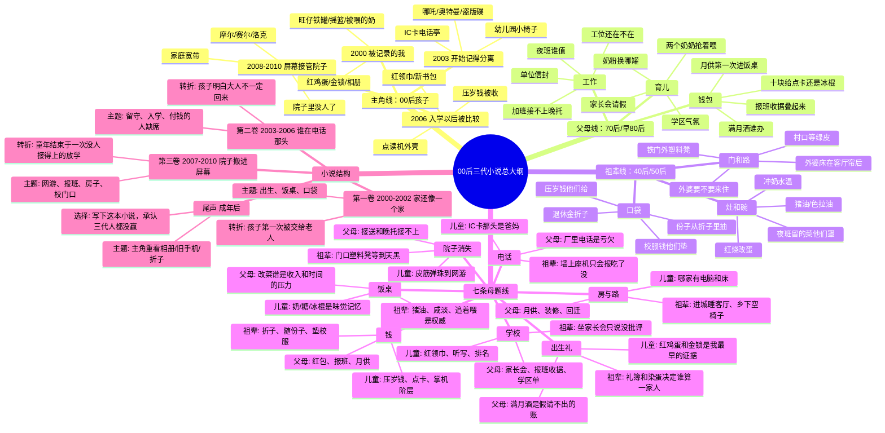

# 00 后三代小说思维导图大纲

> 已归档。分类树，不是因果链。不要当现行大纲。
> 现行稿：[../story-bible.md](../story-bible.md) · [../风格总纲/00-索引.md](../风格总纲/00-索引.md)
> 本夹对照：[因果脑图.md](因果脑图.md) · [主线大纲.md](主线大纲.md)

这张图把三套材料连成小说工程，而不是再做资料索引：儿童库写「我碰到什么」，父母库写「谁付钱、谁请假、谁赶路」，祖辈库写「谁守门、谁端碗、谁垫钱」。小说的主角可以是一个 2000 年出生的孩子，但真正的发动机是三代人在同一个家里争夺「怎么把日子过下去」。

## 总思路

- **中心问题**：一个 00 后长大以后，回头发现自己的童年不是一串玩具和零食，而是三代人用饭桌、电话、红包、床、校门口共同搭出来的。
- **叙事形状**：编织型三代群像。每卷一个生活母题，每个母题同时照到儿童、父母、祖辈。
- **时间轴**：2000 出生与满月，2003 留守电话，2005 隔代争喂，2006 入学与留下/带走，2008 宽带和自己的床，2009 报班与月供加码，2010 铁门、晚托和院子里没人了。
- **主冲突**：孩子想要自己的童年；父母想要孩子别输；祖辈想要一家人别散。三个人都在爱，但爱使用的是不同年代的工具。
- **终点**：2010 年不是故事结束，而是童年从院子转进屏幕、从家里转进账单、从三代同堂转进各自孤独的起点。

## Mermaid 思维导图

## 小说主干

### 一句话故事

2000 年出生的孩子长到 2010 年，原以为自己的童年是旺仔铁罐、点读机、摩尔庄园和校门口冰柜；成年后才发现，每一样东西背后都有父母的加班、月供和假条，也有祖辈的折子、灶台和门口塑料凳。

### 主要人物

- **孩子**：2000 年出生，城/县/乡之间可以按故事需要确定。表层想要玩、吃、看、被同学承认；深层想要知道自己到底被谁养大。
- **母亲**：1975 左右出生，主线是「想补偿孩子，又被工作和钱追着跑」。她的爱表现为买单、签字、报班、催促。
- **父亲**：1970–1980 之间出生，主线是「想撑住家，但经常不在场」。他常出现在信封、班车、夜班、电话和车喇叭里。
- **奶奶/外婆**：1945–1952 左右出生，主线是「我带大的孩子，凭什么说我带错」。她们端碗、看门、垫钱，也制造最具体的家庭摩擦。
- **爷爷/外公**：1940–1955 左右出生，主线是「规矩和沉默」。他骑车接、守电视、数折子、在关键时刻一句话把家压住。

## 分卷大纲

### 第一卷：红鸡蛋和铁罐（2000–2002）

**卷眼**：孩子还没有记忆，但家里所有人都在争夺「谁有资格说这是我带大的」。

- 开篇场景：满月酒，祖辈染红鸡蛋管礼簿，父母算几桌和假条，孩子被相册固定成「全家的希望」。
- 日常推进：奶粉水温、旺仔铁罐、过年糖果、豆浆油条、猪油色拉油，把「吃什么」变成第一代育儿权力战。
- 中段转折：父母工作开始把人从家里抽走，孩子第一次被交给祖辈，空椅子和少一双筷子进入家。
- 卷尾：墙上座机只问「吃了没」，孩子还小，但家已经开始分成电话这头和电话那头。

### 第二卷：电话那头的人（2003–2006）

**卷眼**：孩子开始有自己的感受，父母开始有越来越厚的账，祖辈开始真正成为日常抚养者。

- 开篇场景：2003 年电话亭/IC 卡，孩子对着听筒说不完，父母在厂里赶时间，祖辈在灶边替他解释。
- 学前与入学：幼儿园小椅子、午睡豆浆、红领巾、新书包、校服八十块。学校让孩子进入比较系统，也让父母和祖辈进入付费系统。
- 家庭冲突升级：奶粉换罐、两个奶奶抢勺、家长会谁去、点读机谁买。每个选择表面是小事，实际都在问「谁说了算」。
- 卷尾：孩子听见大人争论「留下还是带走」。他第一次意识到自己不是纯粹被爱，也是被安排。

### 第三卷：院子里没人了（2007–2010）

**卷眼**：童年从院子、饭桌、电视机前，转进电脑、点卡、补习班和车后座。

- 开篇场景：2007 年校门口，孩子想要名牌鞋、冰棍、网吧十块钱；父母在加班接送之间错位；祖辈在门口等到天黑。
- 屏幕推进：4399、QQ 秀、摩尔、赛尔、洛克、宽带绿灯。孩子获得新世界，也开始从家里撤退。
- 钱包压力：月供加码、报班收据、点卡、掌机阶层、学区单。父母越来越像账本，祖辈越来越像备用钱包。
- 最后一场：晚托散了，父母还没下班，祖辈骑车/坐凳/扶腰来接，孩子却只想回去上线。三代人在校门口同框，但心已经不在同一个年代。

### 尾声：成年后的回看

成年后的 00 后整理旧物：相册、铁罐、IC 卡、点读机、折子、旧诺基亚、同学录。他终于明白，自己的童年不是「被毁了」或「很幸福」这么简单，而是三代人都用自己会的方式拼命爱过，但谁都没有完整地理解别人。

## 后续补齐清单

- 祖辈库建议补 `00-索引.md`，并单独做 `带孙.md`，把「追着喂、偏方、两家抢带、孙子孙女标准」从年份篇里抽出来。
- 小说需要单独建 `story-bible.md`：确定主角性别、城乡位置、父母职业、主要祖辈是谁、叙述视角是一人回忆还是多 POV。
- 如果要写成长篇，下一步应把这张图拆成 24–36 个章节节拍，每章只抓一个物件和一个家庭选择。
