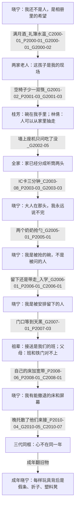
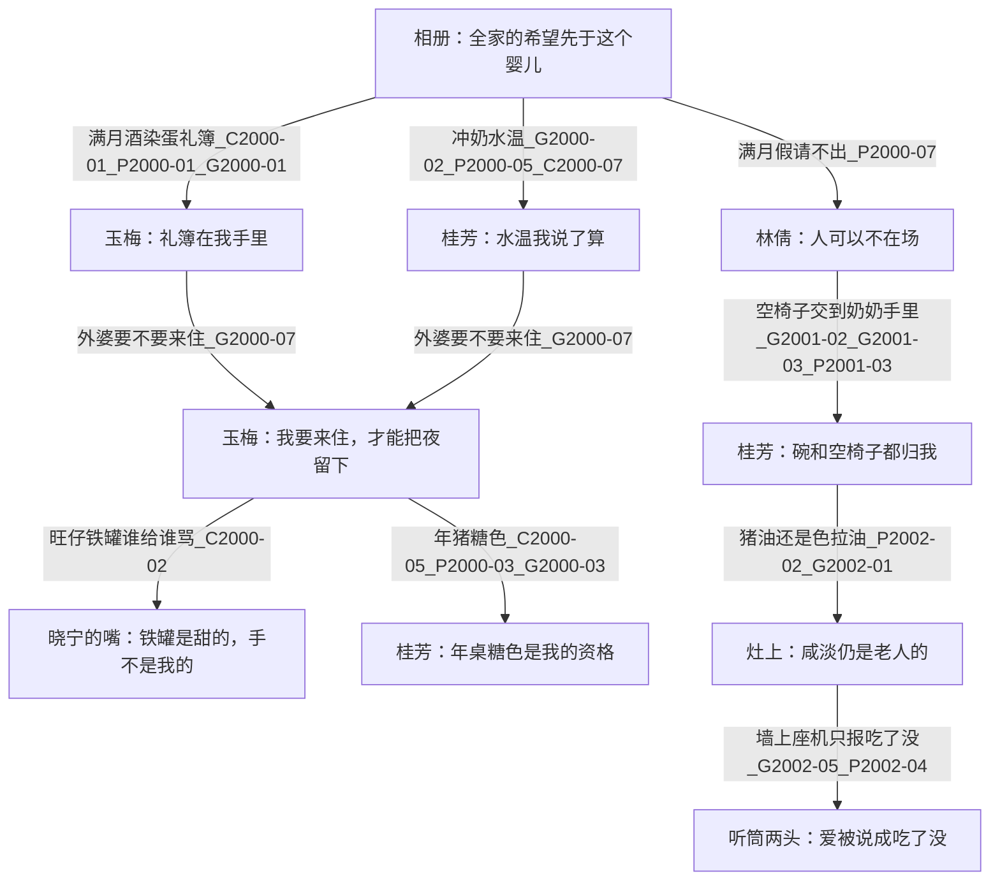
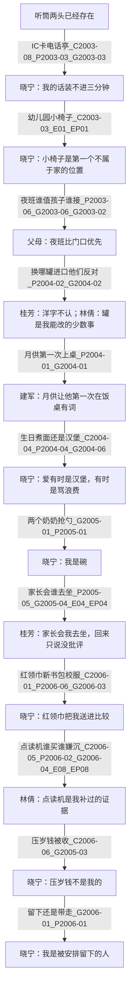
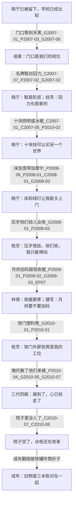

# 00 后三代小说 · 直线因果脑图

配套：[story-bible.md](story-bible.md)、[主线大纲.md](主线大纲.md)。

读法：

- **节点** = 某个人在某一刻的「以为 / 知道」。
- **直线** = 一件家里碰得到的事（挂三库卡号）。
- **箭头指向** = 这件事改写了谁的知道。
- 能对调两条线的顺序，这条线就没有因果，要删。

不用放射状 mindmap。四张都是 `flowchart TB` 直线。

---

## 图一 · 总脊（九年不可对调）

| 直线事件 | 卡号 | 谁因此知道了什么 | 为什么不能提前 |
|---|---|---|---|
| 满月酒：礼簿、染蛋、水温 | C-2000-01 P-2000-01 P-2000-07 G-2000-01 G-2000-02 | 赵玉梅：礼簿在我手里才算娘家。周桂芳：水温我说了算。林倩：酒可以办，人可以不在场。晓宁：无记忆，只被写成希望。 | 没有「谁有资格带」，后面抢勺、来住都没有账本。 |
| 空椅子 / 少一双筷，会走的孩子交到奶奶手里 | G-2001-02 G-2001-03 P-2001-03 P-2001-07 | 周桂芳：日常的碗是我的。林倩 / 周建军：班上能把人从家里抽走。 | 必须先有满月的资格战，才有「交给谁」；孩子还不会走时交不出手。 |
| 墙上座机只报吃了没 | G-2002-05 P-2000-02 | 孩子开始把爱听成套话。老人学会用一句把电话结束。父母学会报平安等于尽职。 | 没有空椅子，座机不是「两头」，只是家具。 |
| IC 卡，孩子说不完 | C-2003-08 P-2003-03 G-2003-03 | 晓宁：那头有人，我的话装不进听筒。父母：亏欠可以压成三分钟。老人：替他说「吃了、听话」。 | 孩子必须先会说话、先习惯套话，才痛得起来。 |
| 两个奶奶抢勺 | G-2005-01 P-2005-01 | 晓宁：自己是碗。桂芳 / 玉梅：谁怀里转，谁赢今天。林倩：科学说得出口，手伸不过去。 | 没有换罐、来住、月供，抢勺只是拌嘴，不是权力。中点前必须让孩子看见「没人问我」。 |
| 留下还是带走 + 红领巾入学 | G-2006-01 P-2006-01 C-2006-01 P-2006-06 | 晓宁：我是被安排的。祖辈点头留下 = 日常归他们。父母：学校开始要钱，人仍可以不在。 | 入学把孩子送进比较系统；「留下」必须发生在他听得懂自己被讨论之后。 |
| 门口等到天黑 | G-2007-01 P-2007-03 | 祖辈：接送是第二份班。父母：加班和铁门不是一套钟。晓宁：最后一个来的不一定是爸妈。 | 入学后才有铁门钟点；留下之后，接的人已是老人。 |
| 自己的床 + 宽带 | P-2008-06 P-2008-01 C-2008-01 C-2008-07 G-2008-03 | 晓宁：我有能关上门的地方。桂芳：费电、人不在灶边。林倩：电脑是为了学习。 | 没有门口错位，屏幕就不是撤退，只是新玩具。 |
| 晚托散了，他们来接；院子没人 | P-2010-04 G-2010-05 G-2010-01 C-2010-07 | 三代同框，心不在同一年。晓宁只要上线。老人只要接到。父母只要还没迟到到看不见。 | 必须先有床和屏幕，孩子才会在被接住时仍想离开。 |
| 成年翻旧物 | 尾声 | 晓宁：铁罐、IC 卡、折子、塑料凳是同一件事的三面。 | 十年现场没发生，回看只是抒情。 |

---

## 图二 · 卷一 红鸡蛋和铁罐（2000–2002）

卷眼：孩子还没有记忆。家里所有人在争「谁有资格说是我带大的」。

| 直线事件 | 卡号 | 谁因此知道了什么 | 为什么不能提前 |
|---|---|---|---|
| 满月酒：几桌、红鸡蛋、金锁、相册 | C-2000-01 P-2000-01 G-2000-01 | 赵玉梅：礼簿是资格。周桂芳：蛋是我染的，场在婆家。周志刚：这桌要正。晓宁：无。 | 开篇。希望先于人。 |
| 冲奶，水温谁定 | G-2000-02 P-2000-05 C-2000-07 | 周桂芳：科学抵不过烫腕子。林倩：罐是我买的，勺不在我手里。 | 酒上的资格必须落到每天的那一勺，否则只是场面。 |
| 满月假请不出 | P-2000-07 P-2000-06 P-2000-02 | 林倩：酒办了，人不在，仍算尽过心。周建军：寻呼机比产房响。 | 与礼簿同场或紧接：人缺席和老人在场必须同时成立。 |
| 外婆要不要来住 | G-2000-07 G-2001-06 | 赵玉梅：不睡过来，礼簿只是一张纸。周桂芳：客厅多一张床就是少一块地。钱厚德：送人，茶不喝。 | 必须先有礼簿和水温两笔账，来住才是争夺，不是串门。 |
| 旺仔铁罐 | C-2000-02 | 晓宁（身体）：甜。周桂芳：给多了要被姐妹说惯。赵玉梅：我给，才像娘家舍得。林倩：又是一笔被老人决定的嘴。 | 外婆住进来之后，铁罐才有「谁给的」标签。 |
| 年猪 / 糖色 / 过年桌 | C-2000-05 P-2000-03 G-2000-03 | 周桂芳：糖色是我炒的，年还在我的灶上。林倩：红烧是面子，不是每天。 | 日常铁罐之后，才用年桌把「谁家的年」放大。 |
| 空椅子，会走的孩子交到他们手里 | G-2001-02 G-2001-03 P-2001-03 P-2001-07 P-2001-05 | 周桂芳：人走了，班交给我。林倩：留给老人等于自己认输一天。晓宁：学步的手抓到的是奶奶，不是妈。 | 父母必须先被班上抽过（假条、信封），空椅子才不是搬家。 |
| 猪油还是色拉油；菜场还是超市 | P-2002-02 P-2002-03 G-2002-01 G-2002-02 G-2002-03 | 老人：淡了就是不管孩子。林倩：油换了，灶还不是我的。 | 碗已在奶奶手里，改油才是权力，不是口味。 |
| 墙上座机只报吃了没；小灵通老人不会回 | G-2002-05 G-2002-07 P-2002-04 | 全家：爱有标准答案。晓宁：那头的声音会断。 | 卷一收束。没有空椅子，这句话只是口头禅。 |

卷一不深挖：幼儿园（孩子还不到）、月供（2004 才进这扇门）、摩尔（2008）。

---

## 图三 · 卷二 电话那头的人（2003–2006）

卷眼：孩子开始有感受。日常抚养者换成祖辈。每个选择都在问谁说了算。

| 直线事件 | 卡号 | 谁因此知道了什么 | 为什么不能提前 |
|---|---|---|---|
| IC 卡 / 电话亭 / 灶边听筒 | C-2003-08 P-2003-03 G-2003-03 | 晓宁：说不完。父母：三分钟等于看过他。老人：替他圆场。 | 卷一听筒套话的升级：孩子终于有要说的，仍被掐断。 |
| 幼儿园小椅子、午睡豆浆 | C-2003-03 E-01 EP-01 | 晓宁：有一个位置写着他的名字，却不是家。林倩：面谈在门外，她又缺席或迟到。 | 先有听筒分离，小椅子才是「外面的家」，不是日常入园散文。 |
| 夜班谁值、孩子谁接；周一怎么走 | P-2003-06 G-2003-06 G-2003-02 P-2003-02 | 周建军：班比门口先响。周桂芳 / 周志刚：接是他们的。晓宁：最后一个影子常常不是爸。 | 入园之后才有固定铁门时间。 |
| 换哪罐；进口字他们不认 | P-2004-02 G-2004-02 P-2000-05 | 林倩：罐是少数能由她改的事。周桂芳：洋字不进灶。晓宁：奶有时突然变味，没人问他。 | 必须先有「水温谁定」，换罐才是夺权，不是购物。禁止写成打假。 |
| 月供第一次上桌；老家贴砖他们监工 | P-2004-01 P-2004-05 G-2004-01 | 周建军：他在饭桌有了词。周桂芳：砖是面子，贷是儿子的事。林倩：这个家开始用数字说话。 | 罐子战之后，房子把「谁说了算」从灶抬到本。2001 年不能预支全员还贷。 |
| 生日：煮面还是汉堡 | C-2004-04 P-2001-02 P-2004-04 G-2004-06 E-14 | 晓宁：被爱有时等于乐园餐。老人：浪费。林倩：付钱的人才能发奖。 | 月供进门后，汉堡是账，不是童年彩页。 |
| 两个奶奶抢勺，衣服谁套 | G-2005-01 P-2005-01 | 晓宁：自己是碗。两边：怀里转就是赢。林倩：她的科学插不进两只胳膊中间。 | 来住、换罐、房子都已选边，抢勺是总爆发，不能提到开篇。 |
| 家长会谁去；回来只说没批评 | P-2005-05 G-2005-04 E-04 EP-03 EP-04 | 周桂芳：我去了，就是没出事。林倩：请假条比成绩单先打败她。晓宁：第几名会从电话里走进家。 | 抢勺之后，学校把「谁代表这孩子」从灶移到门口。 |
| 红领巾、校服、新书包；折子垫八十块 | C-2006-01 P-2006-06 G-2006-03 E-06 EP-06 | 晓宁：比较开始了。林倩：开学一份钱。周桂芳：垫了，就还在这个家里。 | 小学把孩子从两家老人的碗，送进全班的眼睛。 |
| 点读机：谁买、谁当砖、谁被逼着点 | C-2006-05 P-2006-02 G-2006-04 E-08 EP-08 P-2004-03 | 林倩：收据证明她补过了。老人：沉、贵、不像书。晓宁：学习是按键的声音，不是问号。 | 入学后才有「别输」的机器；年份篇不写黄冈流程，制度留给考试/育儿卡作钩子。 |
| 压岁钱被收 | C-2006-06 G-2005-03 P-2008-03 | 晓宁：口袋里的钱会消失。老人：我给的。父母：我收的，是为了以后。 | 孩子必须先进入「我的」意识（书包、零花苗头），收走才是剥夺。 |
| 留下还是带走 | G-2006-01 P-2006-01 G-2006-02 | 晓宁：自己是安排。祖辈点头留下。父母：带走要请假，留下要电话。钱厚德：编织袋可以落地，人不一定留下。 | 卷二收束。前面所有「谁说了算」必须先发生，孩子才能听懂这句在说他。 |

卷二不写成新闻的：2003 的醋和口罩若出现，只写门口洗手、园所停开几天，不写疫情名。

---

## 图四 · 卷三 + 尾声（2007–2010，回看）

卷眼：童年从院子、灶、电视机前，搬进电脑、点卡、补习班和车后座。

| 直线事件 | 卡号 | 谁因此知道了什么 | 为什么不能提前 |
|---|---|---|---|
| 门口等到天黑；外公骑车来接 | G-2007-01 G-2007-06 P-2007-03 G-2007-05 | 祖辈：岗位在铁门。父母：钟点对不上。晓宁：等本身开始不可靠。 | 入学 + 留下之后，接送才成为日常制度。 |
| 名牌鞋：安踏特步对回力 | C-2007-07 P-2007-02 G-2007-02 | 晓宁：脚上也有第几名。桂芳：回力是新的，够了。林倩：又一张她必须补的面子。 | 门口的等待让孩子看见别人的鞋；没有比较系统，鞋只是鞋。 |
| 4399 / 校门口烧烤 / 十块给卡还是冰棍 | C-2007-01 C-2007-05 C-2007-02 P-2010-02 | 晓宁：十块钱可以离开这家人。父母：十块是账。老人：冰棍行，网吧不行。 | 鞋的阶层之后，屏幕是下一档逃法。摩尔未开服，先写网页游戏和十块。 |
| 自己的床、宽带、摩尔；老人说费电 | P-2008-06 P-2008-01 C-2008-01 C-2008-07 G-2008-02 G-2008-03 G-2008-06 | 晓宁：我可以不在灶边。桂芳：人离开粥。林倩：为了学习。赵玉梅：帘后那张床还在，孩子却不往她这边钻。 | 先有十块的外面，再有家里的撤退点，否则宽带是家电清单。 |
| 压岁他们给、儿女收、他们嘀咕 | G-2008-01 P-2008-03 | 桂芳 / 玉梅：钱的方向证明谁还算家长。晓宁：给和收都与他无关。 | 2006 已收过一次；本年换手，写老人的嘀咕，不重写「被收」本身。 |
| 月供加码、报班收据、老人说读学校就行 | P-2009-01 P-2009-02 G-2009-03 EP-07 EP-09 E-07 E-09 | 林倩：收据是她还在的方式。周建军：房和班两头咬。老人：学校够了。晓宁：放学后还有另一间教室。 | 宽带之后，报班是父母把孩子从屏幕里抢回来的账。 |
| 铁门外塑料凳；车喇叭 | G-2010-01 P-2010-01 G-2010-06 | 周桂芳：凳是工位。腰和书包哪个先放，她已经选过了。晓宁：铁门一关，家在门外开始。 | 报班和晚托把钟点推得更晚，凳子才坐得住一整本十年。 |
| 晚托散了，他们来接 | P-2010-04 G-2010-05 G-2010-07 | 接到了。晓宁只要上线。钱厚德的后座还在。林倩 / 周建军还在打卡。 | 卷三高潮。必须先有屏幕欲望，孩子被接住才会心不在场。 |
| 院子里没人了；冰柜收束 | C-2010-07 C-2010-08 | 晓宁：皮筋弹珠那一拨人进了楼和网。老人：门口只剩等。 | 高潮之后的空镜，把十年的院子收掉。 |
| 成年翻旧物 | 尾声两章 | 晓宁：三本账对上了。他不再只用幸福或被毁了。 | 现场走完才能回看。 |

卷三不写：汶川、三鹿、奥运作为情节。福娃若出现，只是文具店毛绒（C-2008-05），一笔带过。

---

## 三条人物「知道」的平行轨

脑图按事件串。下面是同一条十年，拆开看三个人各自学会了什么。写正文时禁止让一个人替别人完成觉醒。

**周晓宁：** 希望（被写成）→ 套话（吃了没）→ 说不完 → 我是碗 → 我是安排 → 鞋和十块 → 门后的屏幕 → 被接住仍想离开 → 旧物对账。

**林倩：** 人可以不在场 → 碗不在我手里 → 三分钟尽职 → 换罐是我能改的 → 请假条打败我 → 收据证明我补过 → 「我知道你忙」。

**周桂芳：** 水温是我的 → 空椅子后碗是我的 → 替他圆听筒 → 抢勺赢日常 → 点头留下 → 门口是岗位 → 费电、人不在灶边 → 凳子还在，孩子心已经走了。

赵玉梅的轨与桂芳对称，赢的是礼簿、来住、寄钱、抢勺、年夜饭这边；输的是孩子最后往屏幕走，不往娘家床走。周建军的轨是信封 → 空筷 → 月供有词 → 喇叭对不上 → 打卡仍没散。周志刚、钱厚德少说话，用坐直、冰棍、车铃、盖被完成他们的知道：家要有规矩；送完就走。

---

## 本轮不画进图的卡

不是作废，是避免脑图变成目录。写作时可作缝、季节、味觉，但**不得另开一条能对调的主直线**：

- 儿童：蓝猫、大风车、天线宝宝、哪吒、奥特曼、四驱、悠悠球、喜羊羊三张、铠甲勇士、巴啦啦、同学录、毕业照——可作章内器物，不改谁知道了什么。
- 父母：脑白金、豆浆油条、方便面值班、电磁炉、工位偷菜——可作班上缝。
- 祖辈：麻将去不去、电视购物、冰箱下乡、银层不刮——可作老人自己的日子，一章最多一笔。
- 社会库全部新闻卡：窗外。

女主替换时，因果句不动，物件换芭比 / 小魔仙 / 摩尔。
