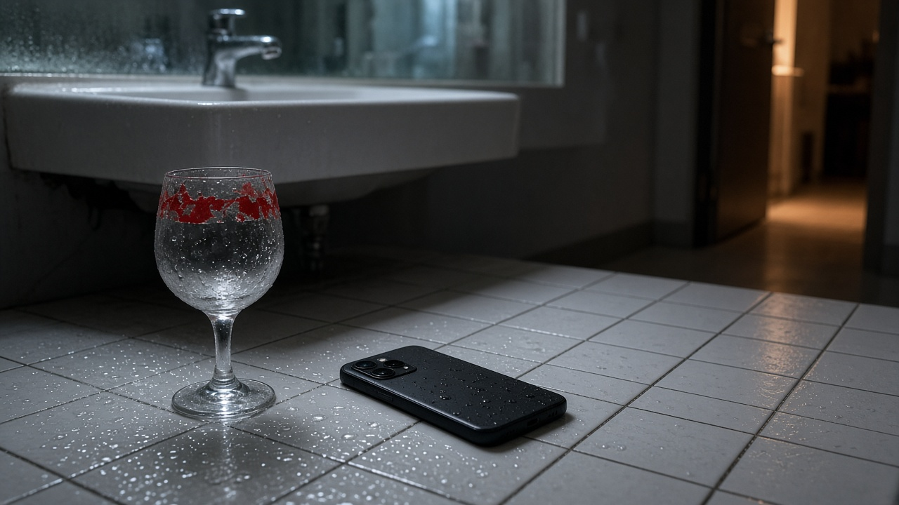
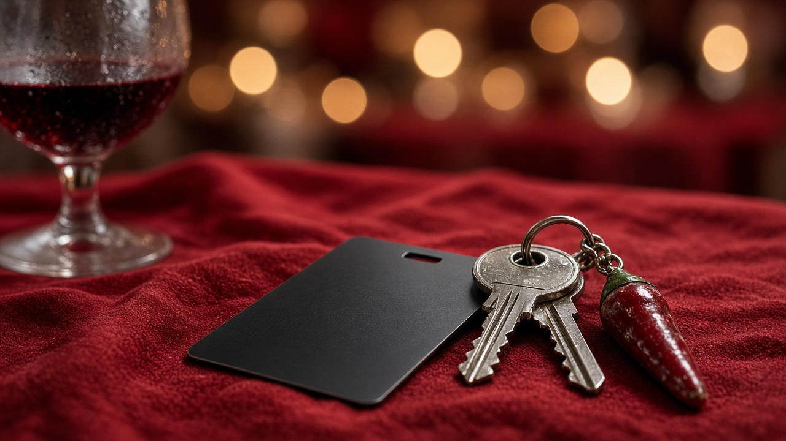
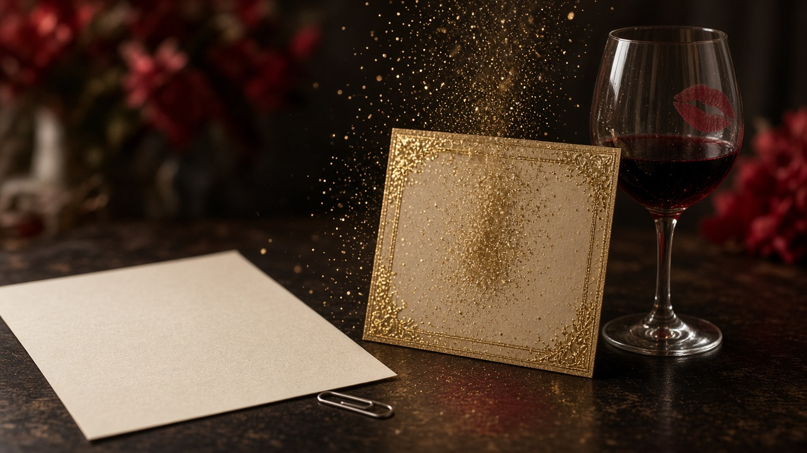
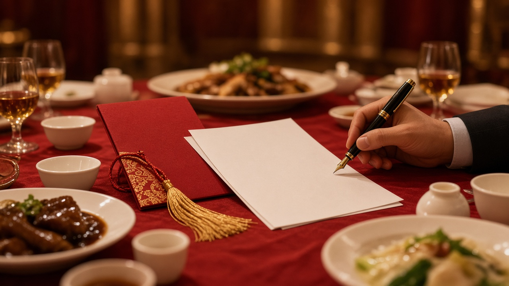
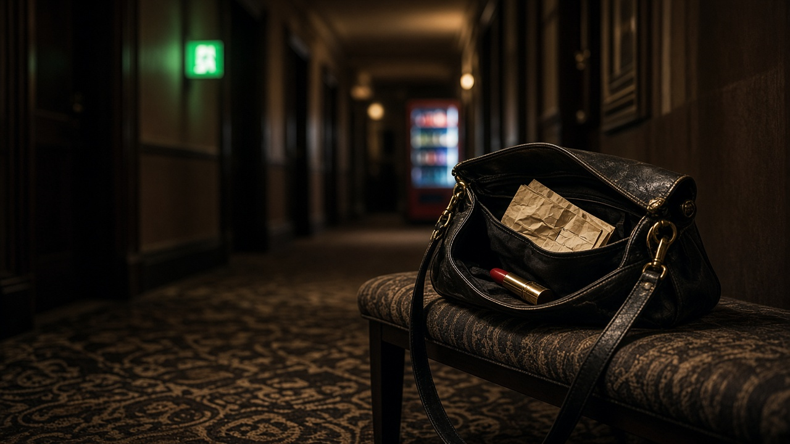
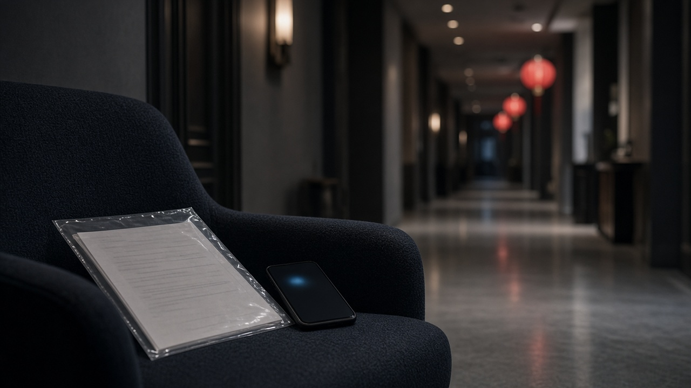

# 弟弟婚房写了我的名

弟弟订婚那天，妈妈把喜糖盒推到我面前。

盒子底下压着一沓贷款补充协议，她说只是补个签名，别耽误新人敬酒。我拿起笔，先看见了复印件上那套婚房的地址，再往上，是产权人一栏里我的名字。

包间里掌声刚响起来，我的手机也亮了，工资卡扣款短信停在三年前的第一笔月供上。

## 01

手机还亮着，工资卡扣款短信停在三年前第一笔月供；复印件被酒气潮着一角，产权人栏里同时是我的名字。

苏晚宁。印得清楚，没有涂改。地址一行写着柳岸苑六栋一单元一二零二。刚才司仪报婚房，报的就是这一套。墙钟指在六点四十一，秒针卡在喜字灯的闪烁里，一顿一顿。

喜糖盒被我掀到转盘边，红盖磕在骨碟上，几颗糖滚到妈妈筷子旁。盒里还剩一层托，托底粘着金纸屑。盒子底下压着那沓贷款补充协议，第一页折痕正抵着我的拇指腹，折痕发亮，像被反复压过。妈妈把笔塞过来，笔帽没拧紧，油墨在签字栏上方洇开一小点。我的席位卡立在杯侧，写着姐姐，卡角已经被酒滴泡软。

“签一下，不耽误你弟敬酒。”

包间里掌声还没散完。晚舟和何棠在主位起身，酒杯相碰，喜字灯一闪一闪。服务员侧身换骨碟，碟沿擦过协议的角，妈妈迅速把纸往喜糖盒底下按，又按不住，纸角从盒沿翘出来。她用筷子把糖拨回去，糖纸沙沙响，盖不住那截纸。

我没签。我把房本复印件平铺在碗和杯之间，纸边很快沾上一圈红汤。我抽了一张餐巾，先按住汤渍，再一行行看。产权人、共有情况、权利性质、房屋性质。共有情况是单独所有。权利人只有我。规划用途写着住宅。附图页只印了个框，框里的门牌和邀请函上的烫金数字对得上。

妈妈用手挡住那一栏，指甲盖住“苏”字。“先把字签了，回头再看。一家人别在席上翻纸。”

我把她的手移开。复印件背面还有浅浅的印章影，像从本上直接扣下来的。我对着包间顶灯照了照，地址栏没有贴改，身份证号末六位和我钱包里那张对得上。钱包夹层里的证件被我抽出半截，又迅速按回去，桌布皱成一道。我用手机对准产权人栏拍了一张，闪光灯打在红汤上，汤面亮了一下。妈妈伸手来挡镜头，挡到的是她自己的袖口。

三年前第一笔月供的短信还停在屏幕上。金额三千六百八十，摘要四个字：住房按揭。尾号三九一六，是我发工资的那张卡。时间是二零二三年九月十五日，扣款渠道写着代扣。屏幕亮度被我调到最高，数字边缘发虚。

我当时回过妈妈一句“收到”。她每月只说卡里扣了家用，让我别转回去。我把那条旧微信也翻到旁边，两条字并排，扣款日对得上。冷盘还没撤，蒜泥味顶上来，我把复印件往上挪了半寸，避开醋碟。席上的公用转盘又被推了一格，鱼头正对着我，鱼眼糊着糖色。我用筷子把鱼头转开，才继续看手机。

笔还在我手里。补充协议标题印着住房贷款，借款人栏也是苏晚宁。第二页被订书钉钉死，只露出“自动扣款”四个字的下半截。我用指甲掀钉脚，掀起一点白茬，下面还有账号栏，数字没完全露出来，只看见末两位，和短信里的贷款账号对得上。钉脚刺了一下指腹，我把血珠按在餐巾角落，没让它落到签字栏里。

晚舟已经绕过两桌。何棠的裙摆扫过椅脚，高跟鞋在地毯上陷了一下。妈妈压低声音，说晚舟刚订婚，说我是姐姐，说别让亲戚看见我翻这些。她把坤包拉链拉上又拉开，像还准备再掏出一沓纸。邻桌有人过来敬酒，酒杯伸到我眼前，我只把杯子抬了抬，沿碰沿，没喝。酒液溅到席位卡上，“姐”字更深了。

我把房本复印件对折，再对折，塞进自己包里最里一层，压在工牌下面。协议我没给她。喜糖盒空盖扣回去，压不住剩下的纸，纸边仍从盒缝里伸出来，像一截舌头。我用骨碟压住盒盖，碟沿还热。盒侧的金字“喜”被我的袖口蹭掉一点，露出底下的灰纸。妈妈看见那点灰，伸手来扶盒子，扶的其实是那沓协议。

妈妈去拦敬酒的队伍，回头还盯着我的笔。我把笔放回转盘，笔骨碌转到何棠空着的座位前，在她的杯垫上停住。杯垫印着酒店名字，一角已经卷起。

我点开短信，拇指按在“住房按揭”四个字上。同一条下面，银行还写了贷款账号。账号很长，末四位眼熟，像我三年前在家里餐桌上抄过一次、又被妈妈说不用管的那一串。我把账号末四位记在席位卡背面，墨水被卡纸吸得发干。

邀请函立在酒坛边，封皮上印着柳岸苑的门牌。我把函拿起来对了一眼，门牌和复印件上的地址一字不差。函被我放回去时，烫金喜字掉了一点碎屑，落进汤碗，浮着不沉。

席位卡背面的账号末四位被我又描了一遍，描到卡纸起毛。掌声再起。我没举杯。我把短信往上滑，下一条日期跳出来——二零二三年十月十五日，还是三千六百八十。第三条只露出一个“住”字，妈妈的手掌已经盖住屏幕。

## 02

妈妈的手掌按在屏幕上，指纹正盖住“住房按揭”。我侧身把手机抽出来，椅脚刮过地毯，发出一声短的。席位卡倒了，姐姐两个字朝下。

包间太吵。我端着杯子往走廊走，杯壁上的喜字贴纸起了边。妈妈跟着出来，坤包带子勒进她肩头，包盖没拉严，协议的角还从里面探着。走廊地毯吸住鞋跟，每一步都沉。墙灯把我们的影子拉长，影子在消防栓上折了一下。

洗手台的感应灯亮了。我把杯子搁在台沿，水汽马上糊住杯底。镜子里能看见她的肩，看不见她的眼睛。短信往上滑，一条、两条、三条，全是同一个尾号，同一个三千六百八十，摘要都是住房按揭。我滑到二零二四年春节那期，扣款日延到十六；再滑到今年八月，金额一分没变。手指在玻璃上拉出一条湿痕，湿痕从九月通到今年。

三十六条。日期多在每月十五，偶尔十六，遇上节假日就延一天。最早那条停在三年前，最新一条就在上个月十五，下午四点零二分。我把列表截了三屏，又把银行软件打开，工资卡流水里同一天总少一截，备注栏写着代扣，商户名是市商行个人贷款。我把三年里同一天的余额也截下来，缺口对齐，像被尺子量过。二零二三年九月到十二月四条，二零二四年十二条，今年到八月八条，我在备忘录里列成三截，数字加总十三万二千四百八十，和三十六乘三千六百八十对得上。备忘录标题我写成“家用”，写完又改成“按揭”，最后只留一个日期。

妈妈伸手来夺。我把手机翻过去，屏幕贴着瓷砖，瓷砖上的水珠滚到充电口。她停住，改去拧水龙头，水冲得太急，溅到她袖口，再溅到她坤包上的喜字吊坠。吊坠转了一圈，停住。

“那不是家用吗？”她说，声音贴着水声，“你每月不也说让家里用？”

我把截图放大。住房按揭四个字在灯光下反白。我把三年前她发我的微信也翻出来，置顶还在：卡里扣了，家用，别转回去。后面跟着一个笑脸。两条信息并在一起，扣款日对得上，分毫不差。我把微信和短信做成一张长图，长图底部是今晚的时间。

她擦袖口，纸抽被她抽出一截，又塞回去。“房子是给晚舟结婚的，钱在家里转，还不是一家人。你现在翻这些，让人听见像你在要账。”

走廊尽头有人笑着过来敬酒，酒杯相碰，笑声贴着墙砖过来，又绕开洗手间门。我把水龙头关掉，杯沿的喜字贴纸被水泡软，我揭下来，揭出一块胶。胶黏在指腹上，怎么搓都还在，搓到皂液盒边，皂液盒是空的。烘手机的指示灯灭了，台面上只剩那圈杯印。我把旧微信的置顶取消，又置顶回去，像确认它还在。

我问她，家用为什么要写成住房按揭。她说银行的字她不懂，说是柜员填的，说我当初也在场。我记起来了。三年前一个周末，她让我去城南支行“办个家里的手续”，叫号纸被她攥软，叫到我的名字时她先站起来。我在柜台签过代扣授权，她在旁边说，就当给家里备一笔，别问那么细。授权书一式两份，她把我那份也收进她的包。

授权书的复印件这会儿不在。在的是我工资卡三年的缺口。洗手台下的垃圾桶里有一张酒店账单，房号不是我们这桌，日期却是今晚，提醒我时间还在走。烘手器突然响，热风把她袖口吹干一块，另一块还湿着。镜子蒙了，我用掌根抹开一道，看见自己领口的喜字胸针歪了，针脚钩着线头。我没扶正。我把胸针取下来，放进杯垫上那摊水里，针面朝下。

手机又震。银行日历弹出下周三的预告：将扣收住房按揭贷款三千六百八十元，请保持账户余额充足。我把预告截下来，和旧短信叠在一个相册里，封面仍是喜糖盒那种红。相册名字我改成“代扣”，又改成日期，最后只留一个点。

妈妈把协议从坤包里抽出来，想再塞回我手里。“补个签名就完了，别让晚舟在里面等。”纸边被水汽潮了，字有点洇。她把坤包放到洗手台上，包底压住一块未干的皂渍，皂渍印到包皮上。我把预告短信的日历页又截了一次，截到通知栏，时间是今晚六点五十八。下周三那一格被系统标成红点，红点旁边还有一句：请保持余额充足。我把这句话圈进相册，圈得发粗。

我把协议轻轻推回她坤包盖上，纸角压住皂渍，没接过手。我把杯子重新端起，杯底一圈水印留在台面上，像个没扣严的盖。走廊地毯吸住我的鞋跟。包间门开着一条缝，喜字灯从缝里漏出来，照见晚舟已经端着酒停在我原来的椅背后，杯壁还烫，何棠的手搭在他小臂上，两个人都侧过脸，在看走廊这边。

## 03

晚舟端着酒停在椅背后，杯壁的热气呵在我后颈上。何棠的手还搭他小臂，戒指在灯下亮了一下，戒托里没有碎钻，只有一道细痕。

我把杯子放回桌上。喜糖盒被谁重新扶正，盒盖却盖不严，协议的角又伸出来。妈妈想把它按回去，晚舟已经看见了纸边，愣了一下，酒液晃过杯沿，滴在桌布上，红的，像汤。服务员过来擦，妈妈把人挡开，说不用。

“姐。”他先叫我，又把酒往前递，“先喝了这杯。外面凉。”

我没接。我把手机亮给他看，短信列表停在那三十六条住房按揭上。屏幕反射他的脸。他看了两秒，眼神飘到何棠脸上，又飘回来，像在找一句能用的。他的拇指在裤缝上擦了擦，没来拿我的手机。

“姐，我以后会还。”

他说以后，手里没有纸。我问他还过没有。他摸裤袋，摸出一串钥匙，门禁卡撞在钥匙齿上，响了一声。卡面印着柳岸苑，下面一行小字是一二零二，卡套边缘已经磨白。他住在那里。他的鞋、他的充电器、他上周让妈妈送去的新床单，都在那里。钥匙扣上还挂着一枚小辣椒，是开业送的那种，漆掉了一半。

我问还款记录。微信、转账、收据，哪样都行。他翻聊天记录，搜索“转账”，弹出的是他给妈妈的生活费，和给何棠买裙子的记录。再搜我的名字，只有节庆红包，金额五十、一百，备注写着姐节日快乐。他改搜“房贷”“月供”“三六八零”，三条都是空的。没有他转给我的月供。没有他进过银行软件的痕迹。贷款账号他报不利索，末四位说成了自己工资卡的，说完又改口，改成生日。他打开自己的钱包，夹层里只有驾驶证和一张饭卡，没有还款回单，没有贷款合同，连一张手写的欠条都没有。钱包边角磨白，磨白处露出一点红色内衬。

何棠松开他的手臂，去拿自己的包。包拉链只开一半，她又拉上，像突然不知道手该放哪。她把杯垫转正，转完又停住。主位背后的拉花掉下一截，落在她肩上，她没摘，红丝贴着锁骨。

晚舟把钥匙握紧，卡齿硌着指节。“我以为房子挂我的名。妈说手续她去办，让我安心上班。首付也是家里凑的，我……我每个月把工资交给妈，她说够用。”他把手机里的工资卡余额也亮了一下，余额只够下周的油钱。

妈妈在旁边插了一句，说他交的是生活费，不是房贷，两笔别混。晚舟的耳朵红了。他把酒杯放下，杯底压住桌布折痕，酒还满着，敬酒的动作做到一半就断了。杯壁上的指纹慢慢散开。他从聊天里翻出一张生活费转账，金额两千，备注写着这个月的。日期是十号，不是十五。十五那天我的卡已经扣过了。他把那张转账举到我眼前，又放下，像知道对不上。何棠的手在桌下碰了他一下，碰完自己先缩回去。

我把房本复印件从包里抽出来，只展开产权人那一栏，推到他面前。苏晚宁。他盯着看，嘴唇动了动，没出声。他伸手想摸那一行，又缩回去，指腹只碰到纸角，把纸角按出一个月牙印。我把月牙印按平，纸还是鼓着。他的酒已经不烫了，杯壁上的水珠滑到桌布，湿了一小片，湿痕正对着我的名字。服务员想撤这杯，被他按住杯沿，酒还满着，像敬酒还没真正开始。

“我真的会还。”他又说了一遍，轻了。还是没有日期，没有金额，没有第一笔从哪天起。他想在餐巾上写点什么，笔不在他手里，笔还在转盘上，滚到何棠的杯垫边。餐巾一抽就散，散成两层，他只在上层写了个“还”字，墨渗到下层，日期仍是空白。他把那张餐巾揉起来，又摊开，字皱了。

转盘被服务员轻轻推了一下，冷盘从他肘边擦过。他侧身让开，钥匙串又响。门禁卡背面贴着一张小纸条，是妈妈的字：密码晚舟生日。纸条边已经起毛，毛边黏着一点灰。我看见那行字，才知道这套房的门，他每天都在开。他想把聊天记录翻给我看“真的没钱”，翻到的是他给装修群转过的定金，群名就叫一二零二。定金不是转给我的。群公告里还钉着一张沙发照片，沙发后面的窗，和房本附图框的朝向像。他把手机扣死，扣在桌布上，屏幕还亮着，被桌布吸住一点光。何棠的筷子在空碗里停着，没夹菜，也没放下。

拉花的胶点粘在她肩上，红了一小块。何棠没有再笑。她把拉花从肩上摘下来，捏在指间，看着复印件，又看看晚舟手里的卡，像把两样东西对到一处。晚舟想把卡塞回口袋，卡角却勾住袋布，一下子翻出来，掉在复印件上，正好盖住我的名字，盖得严严实实。他慌着去捡，指尖碰到卡套的磨白边，何棠比他更快，先按住了那张纸。

## 04

何棠按住复印件，门禁卡还压在我的名字上。她的指甲油碰着纸边，颜色和喜糖盒差不多，只浅一点，甲缘有一道新磕的白。

包间里敬酒的人仍在走动。晚舟想抽回那张卡，她没让，指节撑在桌布上，把纸展平。产权人栏正对着她。她看了两遍，又看邀请函上的婚房地址，两个门牌对在一起。邀请函里那页烫金已经掉粉，粉落在她腕侧的手链上。

“这房子到底是谁的？”

她问晚舟，也问桌上这圈人。声音不高，可转盘停了。汤勺碰着碗沿，响了一下，再没人动。妈妈先去扶她的杯，说别误会，说房子是给你们结婚住的，名字只是当年办贷款方便。何棠没有接杯。她把包重新拉开，抽出一份叠好的纸，是婚前财产说明的空白件，律师事务所的抬头还在，骑缝章浅得像印油快干了。签字栏空着，下面还有一行小字：双方确认后签字。她把纸摊开时，夹层里掉出一枚曲别针，滚到喜糖旁。

“我妈让我带来的。”她说，耳朵红了，仍把纸摊开，“晚舟跟我说婚房是他的。刚才钥匙也是他的。可这栏写的是姐姐。”

晚舟张了张嘴。他看我，又看妈妈，像在等一句能把场圆回去的话。妈妈去捂复印件，何棠按着不放。两只手在纸上对了一下，纸发出很轻的一声。门禁卡被挤到一边，卡面朝上，一二零二对着何棠。妈妈改去按何棠的腕，何棠没松。晚舟去捡掉在桌缝里的曲别针，捡起来不知道别哪，最后别在自己袖口，别歪了。袖口的喜字贴纸因此掀起一角。

我把手机亮到她这边，只亮短信列表，不附加解释。住房按揭，三十六条，尾号三九一六。她的目光从金额移到日期，又移到我工牌绳从包袋里漏出的一截——今天我请了半天假，工牌还没摘，工牌背面的磁条磨白了。她用指尖点了点最新一条短信的时间，又点了点三年前那条，两点之间隔着一整段她没听过的日子。她把邀请函翻到内页，内页印着“新居柳岸苑”，下面还有一行手写：钥匙已交晚舟。字是妈妈的。她把这行对着复印件的产权人栏，两张纸在灯下对了一会儿，手链撞着杯沿，轻响。

“所以月供是姐姐在还？”她问。

她把三十六条短信的截图要过去，自己又滑了一遍，滑到手指发干。滑完把手机还我，屏幕还停在上个月那条。她没有骂人，只把主位上的喜糖拨开两颗，拨出一块能放说明的空。空不大，刚好一张纸。糖纸黏在她指腹，她搓了搓，搓到桌沿，没搓掉。妈妈给她换了一张新餐巾，她没用，把旧的叠好压在说明下。

妈妈说是家用，说家里的钱不分得那么清。何棠点头，点得很慢。她把财产说明往晚舟面前推了一寸，又把一支自己包里的笔压在纸上。“那今天这张也得写清楚。住谁的，还谁的，别等领证那天再补。”笔帽是白的，和席上的喜庆撞开。

她把酒杯放回转盘，口红印正对着复印件上我的名字，杯底压出一圈湿痕。晚舟去拉她，她只是把裙摆理平，坐回主位，脊背仍直。空白说明被空调风吹起一角，又被她用筷子压住。筷尖上还挂着一点糖醋，她用餐巾擦掉，擦完把餐巾叠成方。司仪的麦在门外试音，试到“百年好合”四个字，又忽然关掉。包间里只剩转盘自己转回原位的声音。

妈妈还想笑着把话岔走，说年轻人别较真，说姐姐会帮。她去给何棠夹一块喜糕，糕落到碟里，何棠没动筷。何棠看着我，等我说话。我把复印件抽回一半，只留地址给她看，名字那栏收回包里。她懂了，没再抢，只把地址那一行用指腹按了按，像把门牌记进皮肤。财产说明的空白签字栏被空调吹干，纸边翘起，她用杯底重新压住，口红印叠上湿痕，痕更深了。晚舟想把酒杯重新满上，壶嘴歪了，酒滴到说明的骑缝章上，她用餐巾按住，按完把壶挪开。

晚舟想把邀请函扣回去，扣不严，函里那页烫金又掉了一点粉，掉在财产说明的空白栏里，像提前落下的句号。何棠用指甲把粉拨开，栏还是空的。她把律师事务所的抬头又看了一眼，抬头下的电话被油印糊住，她没有打。她只把说明的第二联撕开一线，又贴回去，像在确认这张纸今晚必须留下痕迹。

门缝里先漏进隔壁厅的鼓点，鼓点一停，包间门开了一条缝。姨妈提着红包走进来，鞋尖先踩到地毯滚边，看见桌上摊开的空白说明和还没盖严的喜糖盒，脚步顿住。红包袋的流苏扫过椅背，她的目光在房本复印件的折痕上停了一停，又落到何棠按着的那张空白说明上，说明的签字栏还空着。

## 05

姨妈的红包袋搁上桌，流苏扫过喜糖盒。她还没坐稳，二叔也从门口挤进来，手里捏着一盘刚切的喜糕，糕上的红字糊了，糊到盘沿。

“咋了这是？”二叔把糕放下，先看何棠，再看我，“新人敬酒敬到一半，纸摊一桌。”

妈妈把补充协议重新抽出来，按在我碗边，说只差一个签名，说银行催得紧，说姐姐签了今晚就能过。碗沿把纸边压出一道油。姨妈听懂了半句，已经绕到我椅背后，手拍我肩，拍得很熟，像拍年夜饭时不肯夹菜的人。

“你是姐姐，帮一下怎么了。”

二叔跟着接，说晚舟结婚不容易，说房子有人住就行，说名分以后再理。姨妈把红包袋推到我手边，像在递台阶：签了，这袋也算心意。袋口没封严，露出一叠新钞的边，钞边还带着银行束带的勒痕。我没碰。袋绳却绕上我手腕，被她轻轻一勒。

何棠坐在主位没动。晚舟想拦，被妈妈眼神按回去。包间里渐渐围了两三个人，都是自家亲戚，没有外姓。他们不看短信，只看协议上的签字栏。栏是空的，日期却已经有人用铅笔描了今天，描得发亮，像提前演过一遍。墙钟走到七点零五，喜字灯还在闪。有人把我的椅子往桌边推了推，椅垫挤着我的膝。茶杯被换成了白酒杯，杯底还湿，印在协议首页的空白处，留下一圈。

我把协议翻到最后一页。条款印得很密。同意继续作为借款人履行还款义务。同意维持现有代扣账户。未经银行书面同意，不得变更还款方式。还款截止年印着二零四三。我用手指顺着年份数，还有十七年。十七年乘以十二，再乘三千六百八十，我在席位卡背面列式，数字大得笔尖发滞。旁边还有一行：若借款人提前结清，须另行申请。没有一行写着弟弟的名字。协议首页的骑缝章只印了半边，另半边大概在银行留底。我把半边章对着灯光看，看不清行名，只看见一个“城”字。姨妈以为我在犹豫，把红包袋又往前推了半寸，袋绳勒进腕骨，勒出一道浅印。

姨妈说算这些多伤感情。二叔说一家人哪有那么多银行。妈妈把笔塞进我指缝，笔帽是热的，像刚被谁含在手里暖过。笔杆上还留着她的指纹，指纹盖住酒店的广告字。

“今晚不签，酒店这桌怎么收场？”妈妈声音发紧，“亲家还在隔壁厅。你让晚舟怎么进去敬酒？”

隔壁又响了一阵鼓点，鼓点停时，能听见亲家那边有人喊晚舟的名字。晚舟的肩膀动了一下，没起身。妈妈把席位卡转到我眼前，姐姐两个字被酒渍泡开。她像要把这两个字当成章，按在协议上。姨妈跟着附和，说亲家马上要过来敬酒，说别让人家看见姐弟在算账。她把红包袋竖起来挡协议，挡不住签字栏，栏还对着我的手。二叔把喜糕盘子转了一圈，转到我面前停住，像在催。盘底的纸垫浸油，油印到协议封面上，封面的银行标志糊了一块。姨妈用红包袋去擦，越擦越花，花到借款人三个字旁边。我把那页掀开，掀到条款页，油没跟过去。

隔壁隐约有掌声。服务员在门口探了一下，又退回去，手里的酒还平端着。何棠抬眼。她没有帮着劝我签，只把那张空白财产说明又往前推了推，纸角抵着协议的签字栏，像两张空纸在对峙。晚舟看着我，嘴唇动了动，最终只说了一句姐。他的钥匙还在桌上，门禁卡正面朝下。

我把笔拿稳，没落下去。签字栏的油墨点还在，是开席时那点，干了，变成一粒黑。协议底下压着喜糖，糖纸沙沙响。姨妈的手还在我肩上，力道不重，却让我没法把椅子往后撤。椅脚顶着她的鞋尖。二叔把我的包从椅背挪到地上，说挡路，工牌绳从包口滑出来，磁卡磕在地毯上。我弯腰去捡，笔几乎落到纸上，我及时收住，笔尖在签字栏外划出一道浅痕，浅痕不算签名。妈妈看见那道痕，眼睛亮了一下，又暗下去。

二叔把喜糕切成小块，硬塞到我碟里，说先吃甜的。糕黏在筷尖上，掉下一块，砸在签字栏里，红字糊住“借款人”三个字。妈妈伸手去抹，越抹越花，花到日期边上。她换餐巾再抹，日期的铅笔痕却更清楚了。二叔又去倒酒，酒溢过杯沿，流到协议第一页的标题上，“补充”两个字洇开。姨妈抽纸去吸，吸完把湿纸团塞进喜糖盒，盒盖因此更盖不严。

我把席位卡背面的算式按住，数字还在。笔仍在我指缝里。笔尖悬着，始终没碰纸。补充协议最后一页的日期写成今天，还款截止年写成二零四三。姨妈又拍了拍我的肩，红包袋的角抵着我手腕，新钞的边刮着皮肤，像要把我的手按到纸上，按到今天的日期里。

## 06

姨妈要把我的手按到纸上。我把笔放下，笔滚到转盘凹槽里，撞了一下杯托，杯托里的牙签散了两根。

“那我们把账打出来看。”

包间忽然静了一寸。我拿出手机，拨通市商行城南支行的客服号，号码是短信里印着的那一串，我当众念出来，免得有人说我乱打。接通后先是一段音乐，音乐里夹着“请您稍候”，再是人工。我报身份证号，报工资卡尾号三九一六，报贷款账号末四位。客服要我做声纹确认，我对着话筒报了两遍姓名：苏晚宁。第二遍时，我把手机抬高，让话筒对着包间中央。

姨妈还站在椅背后。二叔的喜糕搁在碟里，油渗到纸垫上。妈妈伸手来按免提，又停住。我自己把免提打开，把手机扣在空碗上，碗底把声音放大，碗沿还沾着一点红油。空碗是我的，我把筷子架到邻座，免得挡住话筒。话筒网罩上沾了一粒饭，我拨掉，拨到桌布上，没人管。包间的空调忽然加大一档，喜字拉花拍打窗玻璃，拍得很整齐。

客服问我需要办理什么。我说申请近三年完整还款流水，以及这份住房贷款的责任说明。谁是借款人，扣款账户是哪一张卡，已还多少，下一期什么时候扣。请发到预留手机。我把预留号也报了一遍，就是此刻亮着的这台。

验证用了两分钟。客服核对代扣授权，核对预留号码，问我是否本人现场申请。我说是，人在场。她让我等，键盘声从碗里敲出来，一下一下，盖过转盘的轻响。墙钟走到七点十二。等候音里又插进一句“正在为您查询”，包间里没人接话。何棠把财产说明收拢，压在膝上。晚舟的手撑着桌沿，指节发白，门禁卡被他翻过来覆过去，卡套掉了一截线。妈妈看着我，手还停在坤包拉链上。服务员从门口退回去，把一壶热茶留在门边，壶嘴对着我们这桌，没人去斟。

客服回线。她读了一段，不快，每个数字都清楚。借款人：苏晚宁。代扣账户：尾号三九一六。还款方式：工资卡自动扣收。近三十六期，每期三千六百八十，合计十三万二千四百八十。当前无逾期。下一扣款日：下周三。她把合计又重复了一遍，让我确认是否听清。我说听清了。何棠在膝上的说明背面记下这个合计，字很小。晚舟的喉结动了一下，没辩。姨妈想说话，被二叔用筷子杆轻轻点了点手背。点完，筷子杆上的油印到她手背上，她也忘了擦。

姨妈的手从我肩上滑下去。二叔把糕渣搓进掌心。没有人再说“家用”。红包袋的流苏不再动。

我问责任说明里还有没有其他共同还款人。客服说系统显示借款人为单人，补充协议未生效，因此变更项都还空着。她问是否确认发送电子流水和责任说明。我说确认。她让我注意，电子件仅供本人核对，不构成额外承诺。我应了，没把这句话解释成别的。碗里的免提还开着，客服键盘声停了片刻，又响，像在点发送。姨妈后退半步，鞋跟踩到自己的红包绳，绳被拉直。二叔把喜糕盘子推远，推到转盘对面，不再对着我。

妈妈低声说别当这么多人的面。我没挂。客服让我注意查收短信，附件十分钟内到达，纸质件可五个工作日内到城南支行柜台打印，需带身份证原件。我把柜台地址也问清了，记在喜糖盒盖内侧，油笔写在红底上，字发白，写完我把盒盖翻给晚舟看了一眼。何棠把工单号也抄到自己说明背面，抄完把笔搁下，笔在膝上滚到地毯，她没捡，捡的是掉下去的曲别针。曲别针回她手里时，已经不凉了。

免提里客服又问了一句：是否还要办理代扣变更或解除，需另行申请，可走线上或柜台。我看了一眼桌上那支笔，说这一步我稍后自己办。她应了，把工单号报给我，报了两遍。我把工单号抄在协议空白处，正好写在签字栏上方，把那一栏占住。墨水未干，我吹了一下。工单号末三位是一五七，我又写在喜糖盒盖内侧地址下面，两行白字叠着。晚舟看着那两行，没再劝我先签。

喜糖盒盖内侧的柜台地址还没干。亲戚没人再劝我签字。有人想说话，看见免提还亮着，把筷子放下，把话咽回去。转盘自己慢慢停住，汤面还在晃，晃出一圈油花。手机震了一下，银行提示申请已受理，流水和贷款责任说明将发到尾号三九一六。受理号和我抄的工单号对得上，末三位都是一五七。姨妈手里的红包袋滑到桌沿，流苏垂进汤碗边，沾了一点油，油顺着流苏往下，没人伸手去接。

## 07

红包袋停在桌沿，没人捡。客服的忙音散了，包间像被抽走一层热气。司仪还在门外报下一桌，报完又把声音压住，大概听见里面不响了。墙钟走到七点二十，喜字灯照旧闪，闪得空。

妈妈先站起来。她把喜糖盒盖扣严，把补充协议卷成筒，卷了两圈，又松开，纸自己弹开，工单号那一行正对着她。她没再看亲戚，只对我说去走廊。晚舟想跟，被她抬手拦住。何棠看着我，我点一下头，她坐着没动，把财产说明重新叠好，压在膝上。

走廊地毯吸鞋。消防栓上的说明贴边已经卷起。妈妈把坤包抱在身前，拉链拉到一半，又拉开。夹层里除了口红和折叠伞，还有一张旧回单，边已经毛了，毛边黏着一点粉。她捏着，像捏一块烫的。口红盖没拧紧，在包底滚了一下。

“我怕你不肯。”

水声从洗手间里传出来，又停。她把回单递给我。二零二三年八月二十日，市商行城南支行，转账金额八万，附言写着购房首付。付款账户尾号还是三九一六。收款栏是开发商监管户，户名一长串。回单右下角有柜员章，章上的日期比第一笔月供早了二十六天。她的拇指一直盖着金额，盖不住年份，盖不住那个章。我把拇指移开，金额跳出来，八后面是四个零。回单被折过太多次，中缝快裂，我沿着中缝重新对折，对到能放进袋里。走廊的香薰喷了一下，甜得发冲，冲不掉纸上的银行味。

“年终奖那笔也是。”她说，眼睛看着地面，“你那年说先放家里，我没告诉你去向。公积金提取，也用过你的名，一次，窗口那张单我收着。不是一次扣款。是我一路都没说全。”

她又从夹层摸出一张更旧的折页，是公积金提取凭条复印件，姓名栏还是苏晚宁，提取原因写着购房。复印件被折成四折，折痕深得能看见纤维。凭条上的提取金额被她用指甲划过，划痕发亮。我把回单和凭条对到一起，再和房本复印件叠上，三张纸厚了一点，袋口差点咬不住。走廊自动售货机突然落下两罐饮料，不是我们的，罐子滚到墙根，叮的一声，她肩膀抖了一下。

我问她，当初为什么要用我的名。她说我的流水好看，晚舟当时刚换工作，批不下来。她说房子是给弟弟结婚的，名只是暂时的。暂时了三年。走廊灯管嗡了一声，嗡完又稳。她从坤包夹层又摸出一张叫号纸，纸已经软了，上面还有我的名字和三年前的窗口号。叫号纸背面是她写的：办完别多问。字被包里的口红蹭粉了。我把这张也收进袋，和回单叠在一起，窗口号对着柜员章。

“我不是要你跟弟弟断。”她补充，声音发干，“我是怕你算清了就不帮。你从小什么都让。”

让，被她说成一种可靠。我把回单拍进包里，和复印件、截图放一袋。袋口的拉链涩，我拉了两遍才严。她想伸手帮我拉，我侧了一下肩。不是摔门。是拉链只能由我拉上。她把折叠伞从坤包里抽出来又塞回去，伞骨碰到口红，口红在夹层画出一道。她用指腹去擦，越擦越开。墙上的应急灯亮着，把那道红印照得很清楚。

晚舟从门缝探出头。他没进来，只把一张从服务台要来的空白纸递出来，说他想先写怎么还。纸上一个字没有，连日期栏都空着。纸是酒店信笺，抬头印着锦禧两个字，他想把抬头撕掉，撕了半截又停。何棠在他身后，手里仍捏着那份财产说明，空白栏还空着，笔却已经别在纸边。她把笔帽咬出一道牙印，又觉得不妥，用指腹把牙印按平。走廊地毯上有一粒喜糖，不知谁踩过，糖纸破了，黏在我的鞋边。我没捡。

妈妈看着那张白纸，忽然把补充协议也塞过来，说这张先别撕，银行还要。我没撕。我只把签字栏朝外，让她看见工单号压在上面，墨迹已干。她想用手指把工单号抹掉，墨已经吃进纸里，抹出一道灰。晚舟把空白信笺又往前递了递，纸角碰到我的包拉链，拉链齿刮过纸边，刮出毛茬。何棠把那道毛茬按平，按完把手收回去。

包拉链在我掌心勒出一道。手机又震。流水附件到了，文件名一长串数字和字母。下载转了一圈，提示成功，文件落进邮箱，我点开第一页，借款人、账号、已还合计都在，和客服刚报的十三万二千四百八十对得上。第二页是按月明细，十五日那一列齐齐的，金额分毫不差。往下翻，备注栏还有一行字，被截到下一屏，只露出“代扣”两个字的上半截，我拇指停在屏幕边缘，指腹发亮，停在“代扣”那半截上，还没滑开。

## 08

我把下一屏滑开。备注写着：代扣授权可持本人证件办理变更或解除，线上已开放申请入口。没有别人的名字。没有要我继续签补充协议的提示。附件末页还有一行小字：本说明仅反映系统登记信息。

包间里的人渐渐散回各自的桌。服务员开始收冷盘。我没再进去坐主位。服务台借了一支笔，笔筒里只剩两支，礼宾把较短的那支递过来。晚舟把那张空白纸铺在廊椅上，何棠用包当垫，纸才不软。椅面凉，纸边被风掀起，她用手机压住。

他写还款计划。不是口头。每月十五日前，向我尾号三九一六的卡转入三千六百八十，从下个月起，为期三十六期，先还清这三年我已付的本金；剩余贷款他去银行申请变更还款账户，变更不成，仍按期转我，由我代缴并保留回单。第一笔今晚先转两千，余数下周三前补齐。他写完日期，把身份证号也写上，按了指印，印泥是服务台礼宾用的那盒，红得发暗。指印旁边他加了一句：逾期按当期金额补，不另作解释。何棠看过，把一句口头的“以后”划掉，留下日期。纸被廊椅的铆钉顶出一小包，她把纸移开，移到包面上，字才平。服务台的饮水机滴了一滴，滴在计划的“三十六期”上，他把那滴水吸掉，数字还在。

何棠在财产说明上填了两行：现住房产权登记在苏晚宁名下；双方婚前居住使用权另行协商，不把该房产写入共同财产。她没要求我今晚过户，也没要求我把房子留下给谁。她只把说明拍给自己的母亲，回了一句：先把账说明白。发送成功的提示亮了一下。

妈妈坐在旁边，看着他们写，没有再拦。她把喜糖盒里剩下的协议抽出来，在自己那一栏签了名，写的是：家用实为月供，由我向晚宁说明。日期是今天。她把这张纸推到转盘中间，没推给礼宾。写完她把笔搁下，笔帽对不齐，拧了两次。喜糖盒空了，她把盒盖扣上，扣严，像终于不用再藏纸。盒侧那点被蹭掉的金字还在，灰纸露着。她用手遮了一下，没遮住。

晚舟打开手机，转账两千。备注写着还款计划第一笔。验证了指纹，又输了密码。到账提示跳出来时，他的耳朵又红了。我把回单截图，和他刚写的计划订在一起，用服务台的回形针，别住四角中的一角。回形针是歪的，正好卡住工单号那一行。他想再转五百，余额不够，软件弹出余额不足。他把这件事说出来，声音小。何棠把自己的钱包打开，抽出一张银行卡，他摇头，说第一笔必须是他自己的卡。钱包又合上，合出一声轻的。

我可以帮家里，但不能替谁过一辈子。这句话我没当众说完。我说的是另一句。

“以后帮忙要写日期。”

妈妈点头。晚舟应了。何棠把笔帽拧上，咔哒一声。服务台的钟指向九点零八，秒针走过一格，又走一格。礼宾把解约须知的打印件推过来，我没签字，只看了“本人申请”那一行，把打印件折进袋里，和流水附件叠在一起。

我坐在廊椅上，打开银行软件，按客服给的入口申请解除住房贷款代扣。先选贷款账号，再选代扣账户尾号三九一六。人脸识别过了两次，第一次侧光太暗，我挪到灯下，第二次过了，屏幕跳出绿色对勾。系统问是否确认：解除后，尾号三九一六将不再自动扣收该笔贷款，未还部分需由借款人另行安排。我确认。进度条走了两格，停一停，再走完。房子我没要走，钥匙我没收，门禁卡还在晚舟口袋里，卡齿刚才还响过。我只把我的卡从这套扣款里拿出来。解约回执预览页弹出，我先截了屏，再点提交。

等待转圈。圈转了十一秒，进度从提交变成处理中，再变成已完成。喜字灯还在包间里闪。我把解约回执预览再截一次，截到状态那一行。礼宾把解约回执的预览页从我屏幕上扫了一眼，又把视线移开，只把回形针盒子往我这边推了推。我把房本复印件、流水附件、首付回单、还款计划和妈妈那张说明收进同一只文件袋，袋口贴上今晚的工单号，工单号被我又描了一遍，免得磨掉。袋是酒店给的透明袋，透明得能看见产权人三个字，我把复印件翻过去，让地址朝外，名字朝里。晚舟看着那只袋，把钥匙在口袋里握紧，门禁卡轻轻撞了一下椅沿，没再递给我。

文件袋口的工单号被灯照得发白，透明袋里的纸边齐了。手机震了一下，银行提示：您尾号3916账户的个人住房贷款代扣协议已解除，下期将不再自动扣款。
